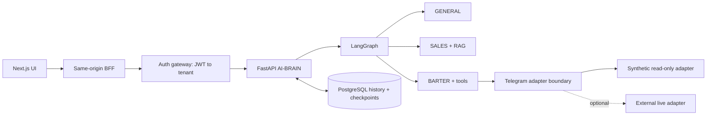

# Telegram AI Automation

**Платформа автоматизации и аналитики Telegram-каналов с AI-ассистентом.** LangGraph выбирает сценарий, FastAPI управляет запросами и историей, Next.js предоставляет интерфейс и BFF, а PostgreSQL хранит диалоги и checkpoints.

Проект показывает полный путь запроса: browser → authentication → tenant-aware gateway → agent workflow → сохранённый ответ. Для знакомства есть синтетический режим без Telegram-аккаунта и OpenAI-ключа.

**Stack:** Python 3.11 · FastAPI · LangGraph · PostgreSQL / pgvector · Next.js 15 · TypeScript · Docker Compose.

[Архитектура](docs/ARCHITECTURE.md) · [Оптимизация](docs/OPTIMIZATION.md) · [Проверки](docs/VERIFICATION.md) · [Подробный запуск](docs/RUNTIME_GUIDE.md)

## Что делает система

| Возможность | Реализация |
| --- | --- |
| AI-ассистент | Маршруты `GENERAL`, `SALES`, `BARTER` |
| Продажи размещений | Сценарий sales-агента с ограниченным RAG-контекстом |
| Подбор партнёров | Barter-агент с tools для поиска каналов и аналитики |
| Аналитика каналов | Dashboard, synthetic demo data, offline parser/feature pipelines |
| Диалоги | История и отдельные LangGraph checkpoints в PostgreSQL |
| Несколько клиентов | Tenant извлекается из JWT; история и checkpoint namespaces разделены |
| Доступ через браузер | JWT в HttpOnly-cookie, same-origin BFF, проверка Origin |
| Репост | Dry-run, структурированное подтверждение, HMAC и idempotency |
| Локальный demo | Mock-модель и read-only Telegram adapter; без внешних отправок |

В mock-режиме проверяются маршрутизация и хранение истории. Он не запускает live RAG, dashboard tools или репосты. Реальная Telegram-интеграция требует отдельного authenticated adapter и сессий вне репозитория.

## Архитектура



Workflow: `load_memory → save_user_message → router → selected_agent → save_ai_message`.

SQL и история не исполняются внутри frontend. Service credentials добавляет gateway, клиентский tenant ID не считается доверенным. Долговременная история и checkpoints — отдельные механизмы.

## Быстрый локальный пример

Требуется Python 3.11. Пример запускает настоящий граф, детерминированные mock-агенты и явно подменённое in-memory хранилище. Он не проверяет PostgreSQL или browser auth.

```bash
git clone https://github.com/semenovjenya/telegram-ai-automation.git
cd telegram-ai-automation
python3.11 -m venv .venv
source .venv/bin/activate
python -m pip install --require-hashes -r requirements-test.lock
python -m examples.offline_demo
```

Результат: три маршрута `GENERAL`, `SALES`, `BARTER`, по две записи истории на сценарий и отсутствие сетевых запросов. Это проверяется отдельным тестом с запрещённым подключением к сети.

## UI через Docker Compose

```bash
docker compose \
  --env-file compose/env/.env.example \
  -f compose/docker-compose.yml \
  up --build --detach --wait
```

UI: `http://localhost:7777`. Demo login: `demo`, password: `demo-password-change-me`. AI-ассистент: `/chat`.

Compose включает UI, auth gateway, AI-BRAIN, PostgreSQL и Telegram mock. Demo credentials предназначены только для локального запуска; production-конфигурация требует отдельных секретов. В окружении подготовки проверена конфигурация Compose, но Docker daemon был недоступен — полный контейнерный smoke здесь не заявляется.

[Подробное руководство](docs/RUNTIME_GUIDE.md) содержит запросы BFF, readiness и инструкции для live-интеграций.

## Оптимизация

- **Маршрутизация без отдельного LLM-запроса:** детерминированный router анализирует текущий вопрос и до четырёх последних сообщений. Это keyword policy, а не универсальное понимание intent.
- **Контроль истории:** модель получает до 30 предыдущих сообщений; текущий вопрос включается один раз.
- **Ограниченный RAG:** `top_k`, ограничение длины фрагментов и общего контекста.
- **Контроль tool outputs:** явный envelope с признаком `truncated`, до 6 000 символов исходных данных.
- **Работа с БД:** connection pool и перенос блокирующих операций в `asyncio.to_thread`.
- **Контроль генерации:** настраиваемый output limit, timeout и ограниченные retries.

В воспроизводимом синтетическом benchmark окно из 50 предыдущих сообщений сокращается до 30: сериализованный вход уменьшается с **14 055 до 8 485 байт — на 39,63%**. Старые сообщения исключаются; это ограничение контекста, а не сжатие без потерь. На коротком окне из 10 сообщений размер не меняется.

```bash
python -m benchmarks.context_budget
```

[Методика, результаты и компромиссы](docs/OPTIMIZATION.md). Экономия токенов, стоимости и latency отдельно не измерялась.

## Карта проекта

| Каталог | Назначение |
| --- | --- |
| `ai_brain/` | API, LangGraph, маршрутизация, agents, memory и tools |
| `auth-backend/` | Authentication и tenant-aware gateway |
| `frontend-new/` | Next.js UI и BFF |
| `compose/` | Локальный stack, synthetic adapter и demo datasets |
| `chatbot/` | Контракт live Telegram adapter и отдельные utilities |
| `parser_local/` | Offline аналитика; не часть default Compose |
| `monitoring/` | Опциональный observability profile |
| `examples/` | Запуск трёх сценариев без credentials |
| `benchmarks/` | Измерение размера контекста |
| `tests/` | Python regression/security tests |
| `docs/ci/` | CI-шаблоны; не активированы в этом репозитории |

## Проверки

```bash
python -m pytest -q
python .github/scripts/repository_guard.py

cd frontend-new
npm ci --ignore-scripts
npm run lint
npm run typecheck
npm test
npm run build
```

Актуальные результаты экспорта и границы проверки — в [VERIFICATION.md](docs/VERIFICATION.md). Шаблоны GitHub Actions сохранены отдельно: текущее подключение GitHub не позволяет устанавливать workflows, поэтому CI-badge не публикуется.

## Границы готовности

- Это самостоятельный портфолио-экспорт с новой Git-историей. Реальные Telegram-сессии, сообщения пользователей и credentials не включены.
- Live Telegram adapter разворачивается отдельно; исходящие сообщения через demo не отправляются.
- Production требует TLS, собственных секретов, backups, rate limits и проверки доступа внешних интеграций.

Репозиторий представляет портфолио-версию проекта и демонстрирует архитектуру, инженерные решения и подходы к разработке. Он не является готовым коммерческим продуктом. Данные и конфигурация адаптированы для публичного размещения; для использования в рабочей среде необходимы дополнительная настройка и проверка интеграций.
