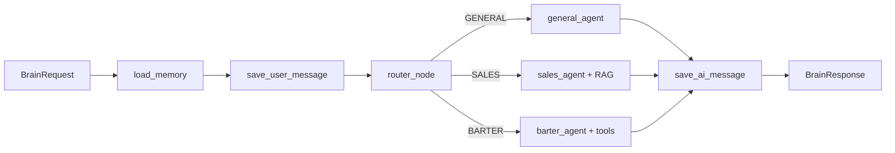

# AI-BRAIN

AI-BRAIN — tenant-safe FastAPI/LangGraph runtime платформы. Он валидирует запрос, загружает долговечную историю, выбирает один из трёх agent routes, сохраняет ответ и checkpoint в PostgreSQL.

Рекомендуемый способ запуска — полный [Compose stack](../compose/README.md). Он поднимает PostgreSQL и synthetic Telegram adapter и работает без внешнего LLM-ключа.

## Graph



| Route | Intent | Node |
|---|---|---|
| `GENERAL` | Общие вопросы | `process_general` |
| `SALES` | Реклама, размещение, стоимость, медиакит | `process_sales` |
| `BARTER` | Партнёрства, похожие каналы, analytics/dashboard | `process_barter` |

Router детерминирован и покрывается unit tests. Он использует текущий текст и ограниченный хвост истории; неизвестное значение безопасно сводится к `GENERAL`.

## Runtime modes

### Zero-credential demo

`LLM_PROVIDER=mock` возвращает детерминированный ответ выбранного агента. Режим не создаёт OpenAI client и не вызывает RAG/dashboard/repost tools.

```bash
docker compose \
  --env-file compose/env/.env.example \
  -f compose/docker-compose.yml \
  up --build --detach --wait
```

### Live LLM

Для реальных model calls задайте через secret manager:

```text
ENVIRONMENT=production
LLM_PROVIDER=openai
OPENAI_API_KEY=<secret>
OPENAI_MODEL=gpt-4o-mini
CHANNEL_SEARCH_URL=https://channel-search.company.tld/api/channel-search
CHANNEL_SEARCH_API_KEY=<distinct-secret>
TELEGRAM_API_URL=https://telegram-adapter.company.tld
TELEGRAM_API_KEY=<distinct-secret>
```

Production/staging validator запрещает mock provider, placeholder/low-entropy credentials, переиспользование секретов и mock/loopback/example/demo integration targets. Каждый live secret имеет минимум 32 символа. Внешние targets используют HTTPS; HTTP разрешён только для внутренних service hostnames. Model timeout и retries ограничены runtime-ом.

## API

Health endpoints публичны для orchestrator. Все data/artifact endpoints требуют `X-API-Key`.

| Method | Endpoint | Назначение |
|---|---|---|
| `GET` | `/health`, `/health/live` | Liveness процесса |
| `GET` | `/health/ready` | PostgreSQL + LangGraph readiness |
| `POST` | `/api/brain/answer` | Выполнить graph request |
| `GET` | `/api/chat/sessions?saas_user_id=…` | Список tenant sessions |
| `GET` | `/api/chat/history/{session_id}?saas_user_id=…` | История tenant session |
| `GET` | `/api/brain/image/{filename}` | Получить разрешённый PNG artifact |

History endpoint отдаёт новейший bounded slice в хронологическом порядке. `messages[].id` и `timestamp` берутся из persisted PostgreSQL row и не меняются при другом `limit`; `returned_count` описывает размер slice, а `total` — полное число сообщений tenant session в том же DB snapshot.

### Direct service request

В production browser/client должен идти через authenticated BFF/gateway. Direct endpoint ниже предназначен для service-to-service интеграции и локальной диагностики.

```bash
curl --fail --silent --show-error \
  -H 'X-API-Key: local-ai-brain-key-change-me' \
  -H 'Content-Type: application/json' \
  -d '{
    "saas_user_id": 1,
    "session_id": "api-demo",
    "chat_id": "api-demo",
    "user_id": "demo-user",
    "message_text": "Найди похожие каналы для бартера",
    "channel_username": "demo_analytics_channel",
    "language": "ru",
    "metadata": {}
  }' \
  http://localhost:8000/api/brain/answer
```

Пример response shape:

```json
{
  "reply_text": "Демо-режим: сценарий подбора партнёров для @demo_analytics_channel готов...",
  "used_agent": "barter",
  "route": "BARTER",
  "metadata": {
    "agent_type": "barter",
    "llm_provider": "mock",
    "demo": true,
    "tools_used": 0
  }
}
```

`BrainRequest` запрещает неизвестные поля, пустые сообщения, oversized metadata и reserved metadata keys. `channel_username` нормализуется. Internal exceptions не возвращаются клиенту; API использует стабильный error envelope:

```json
{
  "error": {
    "code": "PROCESSING_UNAVAILABLE",
    "message": "The AI service is temporarily unavailable",
    "details": {}
  }
}
```

## Tenant-safe persistence

Публичный `session_id` сам по себе не является storage key. Runtime строит UUID5:

```text
tenant:{saas_user_id}:session:{session_id}
```

Эта идентичность используется для history и LangGraph `thread_id`; checkpoint namespace дополнительно содержит tenant. Переданный извне graph config не может подменить эти значения.

PostgreSQL хранит:

- `chat_message_history` — LangChain-compatible user/assistant messages;
- `ai_brain_sessions` — индекс сессий и последнее сообщение;
- tables `AsyncPostgresSaver` — долговечные LangGraph checkpoints.

Schema setup выполняется в FastAPI lifespan. Connection pool переиспользуется, blocking DB calls выносятся из event loop, shutdown закрывает pool/checkpointer.

По умолчанию:

```text
CHECKPOINT_BACKEND=postgres
ALLOW_MEMORY_CHECKPOINT_FALLBACK=false
```

Если PostgreSQL недоступен, startup/readiness не должны изображать готовность. `memory` и explicit fallback предназначены только для изолированных development/tests.

## Tools and side effects

### RAG

Sales/Barter agents получают bounded context через channel search client только в live режиме. `LLM_PROVIDER=mock` не вызывает RAG и tools; synthetic `telegram-mock` проверяется как отдельный read-only adapter contract. Live deployment указывает authenticated adapter/search service.

### Dashboard

Dashboard tool записывает PNG только в `ARTIFACTS_DIR`. HTTP API принимает basename с расширением `.png` и блокирует path traversal; клиент получает `image_filename`, а не filesystem path.

### Repost

Repost tool безопасен по умолчанию:

1. `dry_run=true` создаёт preview exact tenant/source/message/target.
2. Preview возвращает tenant-bound HMAC `confirmation_token` и `idempotency_key`.
3. Отдельный authenticated caller передаёт structured `metadata.repost_confirmation`.
4. Live execution требует `dry_run=false`, `confirmed=true` и точного совпадения обоих значений.
5. Operation атомарно резервируется в idempotency store; duplicate/changed target отклоняется.

Conversational text, LLM tool arguments и tool output не являются разрешением; tool output передаётся модели как bounded untrusted data. Public image не включает private live executor, поэтому demo не может отправлять Telegram-сообщения. В `staging` и `production` обязательны absolute `REPOST_TOOL_PATH`, roots `REPOST_CONFIG_DIR` и `REPOST_INPUT_DIR`, persistent absolute `REPOST_IDEMPOTENCY_DB` и отдельный сильный `REPOST_CONFIRMATION_SECRET`. Tenant `N` может читать только `REPOST_INPUT_DIR/N/forward_post_*.json` и regular non-symlink config `REPOST_CONFIG_DIR/N.json`; symlink и cross-tenant fallback отклоняются.

## Configuration

| Variable | Required | Назначение |
|---|---:|---|
| `ENVIRONMENT` | yes | `development`, `test`, `staging`, `production` |
| `API_KEY` | yes | Service authentication для AI endpoints |
| `POSTGRES_HOST/PORT/DB/USER/PASSWORD` | yes | History и checkpoints |
| `DB_POOL_MIN_SIZE/MAX_SIZE` | no | Границы pool |
| `MODEL_HISTORY_LIMIT` | no | Последние сообщения, передаваемые модели (default `50`) |
| `API_HISTORY_MAX_LIMIT` | no | Жёсткий максимум API-выборки истории (default `1000`) |
| `LLM_PROVIDER` | yes | `mock` или `openai` |
| `OPENAI_API_KEY` | for OpenAI | Provider credential |
| `OPENAI_MODEL`, `OPENAI_TEMPERATURE` | no | Model configuration |
| `MAX_OUTPUT_TOKENS` | no | Жёсткий лимит ответа модели, `64..8192` (default `1200`) |
| `CHECKPOINT_BACKEND` | no | `postgres` по умолчанию |
| `ALLOW_MEMORY_CHECKPOINT_FALLBACK` | no | Explicit volatile fallback |
| `CHANNEL_SEARCH_URL` | staging/production | Search service endpoint |
| `CHANNEL_SEARCH_API_KEY` | staging/production | Уникальный search service credential |
| `TELEGRAM_API_URL`, `TELEGRAM_API_KEY` | staging/production | Telegram adapter contract и уникальный credential |
| `ARTIFACTS_DIR` | no | Разрешённый каталог PNG |
| `LOG_LEVEL` | no | Application log level |

Сверяйтесь с [`config/settings.py`](config/settings.py) и [`compose/env/.env.example`](../compose/env/.env.example); у секретов нет безопасных production defaults. `compose/env/.env.example` — только development demo: его mock URL и общие mock credentials специально отклоняются в staging/production.

## Local development without full UI

Поднимите зависимости с host PostgreSQL port:

```bash
docker compose \
  --env-file compose/env/.env.example \
  -f compose/docker-compose.yml \
  -f compose/compose.override.yml \
  up --detach postgres-vectors telegram-mock
```

Установите Python 3.11 dependencies:

```bash
python3.11 -m venv .venv
source .venv/bin/activate
python -m pip install --require-hashes -r requirements-test.lock
```

Запустите AI-BRAIN из корня репозитория:

```bash
export ENVIRONMENT=development
export API_KEY=local-ai-brain-key-change-me
export POSTGRES_HOST=127.0.0.1
export POSTGRES_PORT=5433
export POSTGRES_DB=chat_history
export POSTGRES_USER=chatbot
export POSTGRES_PASSWORD=local-chatbot-password
export LLM_PROVIDER=mock
export CHECKPOINT_BACKEND=postgres
export ALLOW_MEMORY_CHECKPOINT_FALLBACK=false
export CHANNEL_SEARCH_URL=http://127.0.0.1:8010/api/channel-search

python -m uvicorn ai_brain.api.app:app --reload --port 8000
```

## Tests

Из корня репозитория:

```bash
pytest -q
```

CI дополнительно запускает coverage threshold, frontend gates, dependency audit, image builds и полный Compose smoke. Актуальная архитектура всего stack: [`docs/ARCHITECTURE.md`](../docs/ARCHITECTURE.md).
