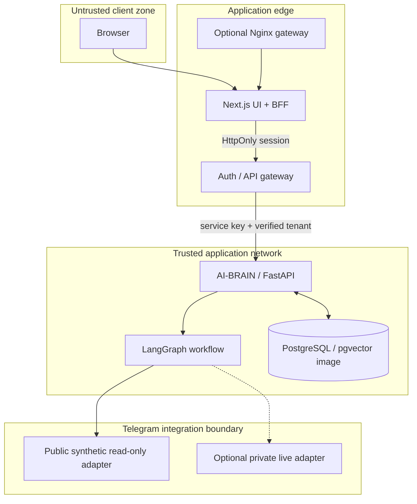
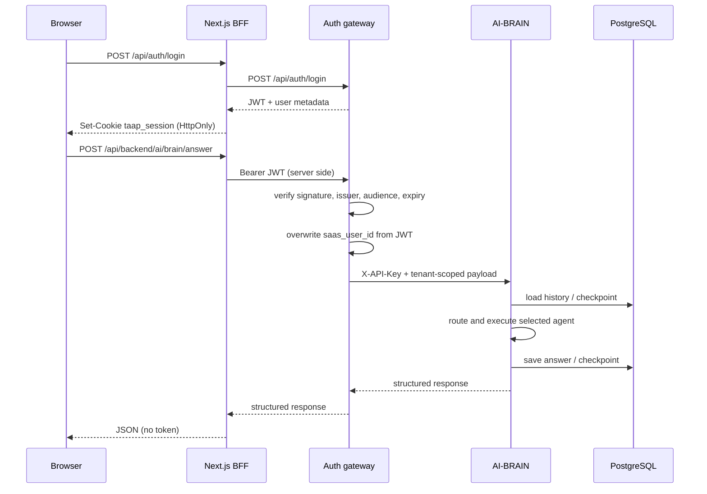
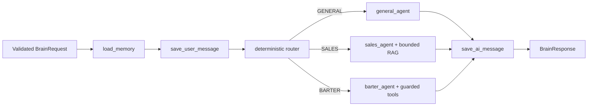

# Архитектура Telegram AI Analytics Platform

Документ фиксирует текущую, проверяемую архитектуру публичного core. Он не предполагает наличия приватного Telegram-кода, session files или внешнего LLM-ключа.

## Цели и инварианты

Система разделяет browser session, пользовательскую идентичность, AI orchestration, долговечное состояние и Telegram-интеграцию. Ключевые инварианты:

1. browser не видит JWT и service API keys;
2. tenant определяется только после проверки JWT;
3. история и checkpoints разделены по tenant/session и сохраняются в PostgreSQL;
4. локальный demo детерминирован и не вызывает внешние LLM/Telegram сервисы;
5. Telegram side effects запрещены по умолчанию и требуют отдельного подтверждения;
6. production-конфигурация должна падать при пустых или демонстрационных секретах.

## System context

В public Compose `PostgreSQL` используется для chat history и LangGraph checkpoints. Образ поддерживает pgvector, но zero-credential `LLM_PROVIDER=mock` не вызывает RAG и tools. `telegram-mock` независимо реализует smoke-tested synthetic adapter contract; настоящая vector collection относится к live data integration.

## Authenticated request path

Next.js принимает только ограниченный allowlist backend-маршрутов (`dashboard`, `ai`, `chatbot`), не следует upstream redirects, потоково ограничивает тело запроса даже без `Content-Length` и удаляет cookie после `401/403`. FastAPI повторяет потоковый лимит на доверенной стороне gateway (8 KiB login, 64 KiB chat message, 1 MiB прочие mutation routes). Изменяющие состояние запросы должны быть same-origin; в staging/production Origin сравнивается только с точным HTTPS `PUBLIC_APP_ORIGIN`, а не с caller-controlled forwarding headers.

## AI-BRAIN graph

Router использует нормализованный текст текущего запроса и ограниченный хвост истории. Неизвестный route безопасно возвращается к `GENERAL`. В `LLM_PROVIDER=mock` agent nodes возвращают детерминированные ответы, не создают OpenAI client и не вызывают RAG, dashboard или repost tools.

### Routes

| Route | Ответственность | Инструменты в live-режиме |
|---|---|---|
| `GENERAL` | Общие вопросы и навигация по возможностям | LLM conversation |
| `SALES` | Реклама, размещение, цена, медиакит | Ограниченный channel RAG |
| `BARTER` | Партнёрства, похожие каналы, dashboard | Channel RAG, dashboard, guarded repost |

## Persistence model

AI-BRAIN использует три вида долговечного состояния:

| State | Хранилище | Namespace |
|---|---|---|
| Chat messages | `chat_message_history` | UUID5 от `tenant:{saas_user_id}:session:{session_id}` |
| Session index/metadata | `ai_brain_sessions` | `(saas_user_id, session_id)` |
| LangGraph checkpoints | Таблицы `AsyncPostgresSaver` | `thread_id` + `checkpoint_ns=tenant:{id}` |

Пользовательский `thread_id` из входного config не считается доверенным и перезаписывается runtime. Схема history/session создаётся идемпотентно при старте. PostgreSQL connection pool переиспользуется между запросами и закрывается в lifespan shutdown.

Default checkpoint backend — PostgreSQL. Если он недоступен, сервис не становится ready и не стартует молча на volatile memory. Memory backend или fallback допускаются только явной development/test конфигурацией.

## Telegram boundary

Ранее `chatbot` указывал на неопубликованный nested repository. В текущей архитектуре это HTTP-контракт, описанный в [`chatbot/README.md`](../chatbot/README.md).

Public Compose запускает `compose/telegram-mock`:

- synthetic channel fixture;
- read-only chat endpoints;
- deterministic channel-search fixture;
- отсутствие Telegram credentials и session files;
- отказ от `PUT/PATCH/DELETE`.

Live adapter разворачивается и защищается отдельно. Он обязан аутентифицировать service calls, проверять подписанный tenant claim, изолировать tenant data, редактировать чувствительные логи и вводить собственную policy для mutating operations. Offline parser в `parser_local/` не подключен к default Compose и не меняет эту runtime boundary.

## Repost safety protocol

Live repost — двухфазная операция:

1. Tool вызывается с `dry_run=true` (значение по умолчанию).
2. Runtime берёт `saas_user_id`, owned channel и chat только из authenticated graph state, затем нормализует source/target.
3. Tenant ID входит в fingerprint, HMAC-bound `confirmation_token`, `idempotency_key` и audit record.
4. Отдельный authenticated запрос передаёт structured `metadata.repost_confirmation` с точными значениями preview.
5. Runtime атомарно резервирует операцию в idempotency store.
6. Повторный или изменённый запрос отклоняется; успешная операция помечается `completed`.

Текст модели, tool output или фразы вроде «да» не являются authority. Tool output оборачивается в bounded untrusted-data envelope. Public image не содержит live executor, поэтому demo физически не может отправить repost. В staging/production config и input разрешаются только из `REPOST_CONFIG_DIR/<saas_user_id>.json` и `REPOST_INPUT_DIR/<saas_user_id>/`; нужны сильный confirmation secret и persistent absolute `REPOST_IDEMPOTENCY_DB`. Временный SQLite path допустим только локально.

## Service readiness and failure model

| Сервис | Readiness/health | Fail-closed условие |
|---|---|---|
| AI-BRAIN | `/health/ready` проверяет DB и graph | Нет PostgreSQL checkpointer/history |
| Auth gateway | `/health` | Production secret/password hash validation |
| Telegram mock | `/health` | Только synthetic read-only mode |
| Frontend | `/` | BFF возвращает controlled `502`, если backend недоступен |

Liveness не заменяет readiness. Оркестратор должен направлять AI traffic только после успешного `/health/ready`.

Browser login-client identity не берётся из `X-Forwarded-For`: BFF создаёт
opaque HttpOnly cookie и подписывает короткоживущий claim отдельным shared
secret. Auth gateway проверяет HMAC, freshness и привязку к canonical username,
после чего limiter применяет client-wide и client/username budgets. Поэтому
единый network peer BFF не объединяет всех пользователей, а один клиент не
может создать глобальную блокировку выбранного username.

## Compose profiles

Default stack:

- `frontend-new`;
- `auth-backend`;
- `ai_brain`;
- `postgres-vectors`;
- `telegram-mock`;

Optional profiles:

- `gateway` — локальный Nginx entrypoint;
- `observability` — Prometheus, Loki, Grafana Alloy, Grafana и изолированный
  GET-only Docker socket proxy. Только proxy монтирует daemon socket; Alloy
  обращается к ограниченному API по внутренней Compose-сети.

`compose.override.yml` открывает PostgreSQL host port только для явной local debugging конфигурации.

## Quality gates

CI проверяет:

- отсутствие gitlinks, generated artifacts и известных secret patterns в текущем tree;
- Python compile и fatal Ruff classes;
- unit/security tests с coverage threshold;
- frontend lint, typecheck, BFF security tests и production build;
- Python/Node dependency audit;
- default и optional Compose configs;
- сборку core images и обязательный Trivy gate для `HIGH`/`CRITICAL` CVE;
- zero-credential Compose smoke: health, login, AI request, persisted session и отдельный synthetic Telegram adapter contract.

Secret scan текущего tree не заменяет отдельную проверку всей Git-истории перед production release.

## Production decisions left to the operator

Репозиторий намеренно не выбирает за оператора:

- cloud/runtime и ingress/TLS implementation;
- secret manager и key rotation process;
- managed PostgreSQL, backup/restore и retention policy;
- конкретный live Telegram adapter;
- rate limits, WAF и tenant quotas;
- log retention и персональные данные;
- legal terms, privacy policy и data-processing agreements для конкретного deployment.

Исходный код самого проекта лицензирован по Apache License 2.0; лицензии
сторонних компонентов определяются их правообладателями.

Перед live-развёртыванием используйте [`docs/PUBLIC_RELEASE_CHECKLIST.md`](PUBLIC_RELEASE_CHECKLIST.md).
