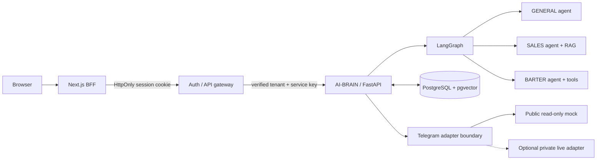
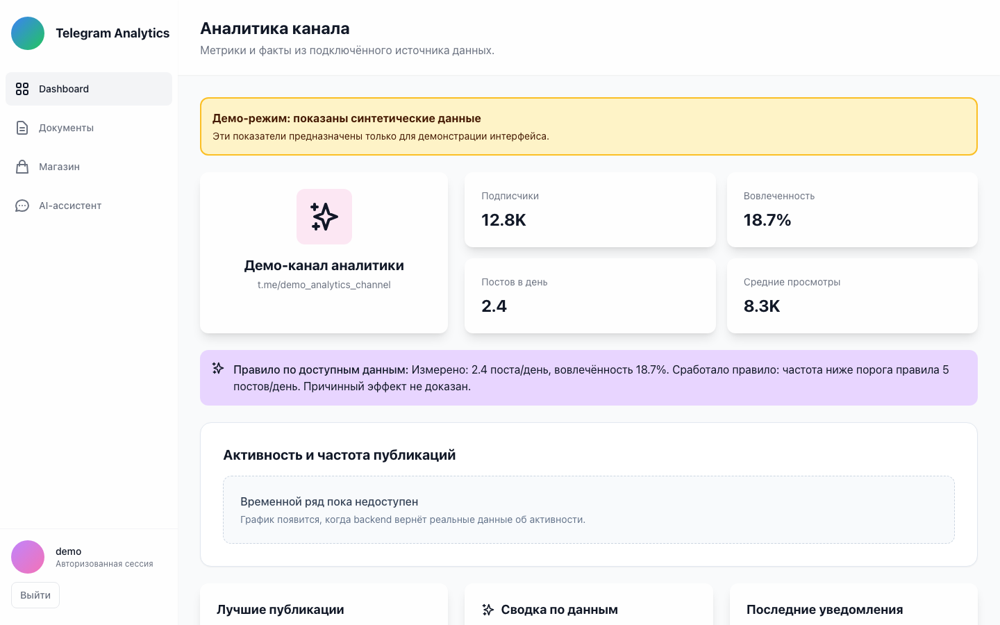
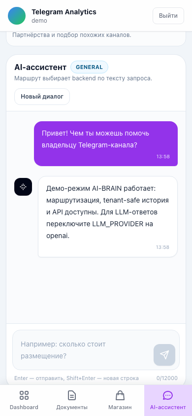

> Подробное руководство исходной платформы. В этом портфолио CI сохранён как шаблоны в `docs/ci`, но не активирован. Проверки этого экспорта перечислены в `VERIFICATION.md`; исторические утверждения о CI не являются результатом нового запуска.

# Telegram AI Analytics Platform


[](../LICENSE)

Multi-tenant платформа для аналитики Telegram-каналов и AI-сценариев: FastAPI, LangGraph, RAG, PostgreSQL/pgvector, Next.js BFF и безопасная граница Telegram-интеграции.

Публичный контур полностью воспроизводим: один Compose-запуск поднимает UI, auth/API gateway, AI-BRAIN, PostgreSQL и read-only Telegram mock. Для golden path не нужны OpenAI-ключ, Telegram-аккаунт или приватный репозиторий.

## Что здесь реализовано

- LangGraph workflow с тремя проверяемыми маршрутами: `GENERAL`, `SALES`, `BARTER`.
- Долговечные LangGraph checkpoints и история диалогов в PostgreSQL.
- Tenant isolation: ключ хранения и checkpoint namespace строятся из `saas_user_id` и `session_id`.
- Next.js Backend-for-Frontend: JWT остаётся в `HttpOnly`, `SameSite=Strict` cookie и не попадает в browser JavaScript.
- Auth gateway сам извлекает tenant из проверенного JWT и подставляет service API key при вызове AI-BRAIN.
- Детерминированный `LLM_PROVIDER=mock` для локального demo и CI; OpenAI подключается отдельно.
- Публичный synthetic Telegram adapter для независимой проверки read-only контракта; реальные сессии и credentials остаются вне репозитория.
- Repost workflow с двумя фазами: dry run, затем отдельное структурированное подтверждение с HMAC-токеном и idempotency key.
- CI для Python-тестов и coverage, frontend lint/typecheck/build, dependency audit, Compose smoke и сборки контейнеров.

## Архитектура



Полная схема, последовательности запросов и модель хранения описаны в [docs/ARCHITECTURE.md](ARCHITECTURE.md).

## Интерфейс

Dashboard сразу маркирует synthetic data и не выдаёт демонстрационные метрики за live-аналитику.



AI-ассистент доступен и на мобильном экране: запрос проходит backend-маршрутизацию, а ответ и история сохраняются через BFF без JWT в browser JavaScript.

<p align="center">
  
</p>

## Быстрый старт без credentials

Потребуются Docker Engine/Desktop и Docker Compose v2.

```bash
git clone https://github.com/semenovjenya/telegram-ai-automation.git
cd telegram-ai-automation

docker compose \
  --env-file compose/env/.env.example \
  -f compose/docker-compose.yml \
  up --build --detach --wait
```

Откройте [http://localhost:7777](http://localhost:7777) и войдите:

```text
login:    demo
password: demo-password-change-me
```

Перейдите в **AI-ассистент** или откройте [http://localhost:7777/chat](http://localhost:7777/chat). Три one-click сценария проверяют `GENERAL`, `SALES` и `BARTER`; история диалога повторно загружается из PostgreSQL.

Локальные значения из `.env.example` предназначены только для demo. Они блокируются production-валидацией.

Проверить состояние:

```bash
docker compose \
  --env-file compose/env/.env.example \
  -f compose/docker-compose.yml \
  ps

curl --fail http://localhost:8000/health/ready
```

Readiness AI-BRAIN должен вернуть `"checkpoint_backend":"postgres"`.

Остановить стек, сохранив данные:

```bash
docker compose \
  --env-file compose/env/.env.example \
  -f compose/docker-compose.yml \
  down
```

Добавьте `--volumes`, только если хотите удалить локальную PostgreSQL-историю.

## Проверяемый end-to-end запрос через BFF

Этот путь повторяет browser security model: login возвращает только сведения о сессии, а JWT сохраняется сервером Next.js в `HttpOnly` cookie.

```bash
COOKIE_JAR="$(mktemp)"

curl --fail --silent --show-error \
  -c "$COOKIE_JAR" \
  -H 'Origin: http://localhost:7777' \
  -H 'Content-Type: application/json' \
  -d '{"username":"demo","password":"demo-password-change-me"}' \
  http://localhost:7777/api/auth/login

curl --fail --silent --show-error \
  -b "$COOKIE_JAR" \
  -H 'Origin: http://localhost:7777' \
  -H 'Content-Type: application/json' \
  -d '{
    "session_id":"readme-demo",
    "chat_id":"readme-demo",
    "user_id":"demo-user",
    "message_text":"Сколько стоит размещение в канале?",
    "channel_username":"demo_analytics_channel",
    "language":"ru"
  }' \
  http://localhost:7777/api/backend/ai/brain/answer

curl --fail --silent --show-error \
  -b "$COOKIE_JAR" \
  http://localhost:7777/api/backend/ai/chat/history/readme-demo

rm -f "$COOKIE_JAR"
```

В demo-режиме запрос детерминированно попадёт в `SALES`; история сохранится в PostgreSQL. CI проверяет AI-запрос и persisted history, а synthetic Telegram adapter — как отдельный read-only контракт.

## Маршрутизация AI-BRAIN

| Route | Когда выбирается | Возможности live-агента |
|---|---|---|
| `GENERAL` | Общий вопрос без sales/barter intent | Общий conversational agent |
| `SALES` | Цена, реклама, размещение, медиакит | Sales agent с ограниченным RAG-контекстом |
| `BARTER` | Партнёрство, подбор похожих каналов, дашборд | Barter agent с RAG, dashboard и guarded repost tools |

В zero-credential режиме `LLM_PROVIDER=mock` маршруты и сохранение истории работают, но RAG, dashboard и repost tools не вызываются. Synthetic Telegram adapter проверяется независимо и не является synthetic RAG-выполнением.

Workflow:

```text
load_memory → save_user_message → router → selected_agent → save_ai_message
```

История сообщений и checkpoints — разные долговечные механизмы в одной PostgreSQL-инсталляции. AI-BRAIN не переходит на memory checkpointing молча: fallback возможен только при явном `ALLOW_MEMORY_CHECKPOINT_FALLBACK=true`.

## Demo и live-интеграции

| Контур | По умолчанию | Для production |
|---|---|---|
| LLM | Детерминированный `mock` | `LLM_PROVIDER=openai` + ключ из secret manager |
| Telegram | Synthetic read-only adapter | Отдельно развёрнутый authenticated adapter |
| Repost | Live execution недоступен | Двухфазное подтверждение + persistent idempotency store |
| Secrets | Явные локальные demo-значения | Уникальные секреты, TLS и managed secret storage |
| Observability | Необязательный Compose profile | Prometheus/Loki/Alloy/Grafana; Docker API доступен Alloy только через GET-only socket proxy |

Контракт live-адаптера описан в [chatbot/README.md](../chatbot/README.md). Telegram session files, пользовательские чаты и live account runtime намеренно не входят в воспроизводимый default stack; offline parser/legacy adapter utilities не подключены к Compose.

## Security boundaries

- Browser не получает JWT или service API keys: запросы идут через same-origin BFF.
- Изменяющие состояние BFF-запросы проходят Origin/Sec-Fetch-Site проверку.
- Tenant ID берётся из проверенного JWT; переданный клиентом `saas_user_id` перезаписывается gateway.
- AI и Telegram endpoints требуют отдельные service credentials в live-контуре.
- Секреты не логируются; production-конфигурация отказывает в старте с пустыми или placeholder-значениями.
- Разговорная фраза никогда не считается разрешением на repost. Live-вызов требует точное структурированное подтверждение результата dry run.
- Public Telegram mock не отправляет и не изменяет сообщения.

Политика раскрытия уязвимостей: [SECURITY.md](../SECURITY.md). Перед live-развёртыванием пройдите [production checklist](PUBLIC_RELEASE_CHECKLIST.md).

## Карта репозитория

| Путь | Назначение |
|---|---|
| `ai_brain/` | FastAPI + LangGraph runtime, agents, memory, tools |
| `auth-backend/` | JWT authentication, tenant-aware API gateway, demo dashboard data |
| `frontend-new/` | Next.js UI и same-origin BFF |
| `compose/` | Самодостаточный stack, mock adapter, gateway и profiles |
| `chatbot/` | Публичный контракт внешнего Telegram adapter |
| `parser_local/` | Offline Telegram analytics/feature pipelines; не часть default stack |
| `monitoring/` | Необязательный Prometheus/Loki/Alloy/Grafana profile |
| `tests/` | Python unit/security regression tests |
| `.github/` | CI, smoke/guard scripts, Dependabot и community templates |

## Проверки качества

Python:

```bash
python3.11 -m venv .venv
source .venv/bin/activate
python -m pip install --require-hashes -r requirements-test.lock
pytest -q
```

Frontend:

```bash
cd frontend-new
npm ci
npm run lint
npm run typecheck
npm test
npm run build
```

Compose smoke:

```bash
docker compose \
  --env-file compose/env/.env.example \
  -f compose/docker-compose.yml \
  up --build --detach --wait

python .github/scripts/smoke_test.py
```

CI также валидирует дерево публичного репозитория, YAML/Compose, dependency
vulnerabilities, сборку каждого core-контейнера и блокирует image с
неустранёнными `HIGH`/`CRITICAL` CVE через SHA-pinned Trivy. Coverage-порог
закреплён в workflow; README намеренно не дублирует меняющиеся счётчики тестов
и процентов.

## Production checklist

До подключения реальных Telegram/LLM данных необходимо:

1. Отозвать любые credentials, которые когда-либо попадали в Git, и проверить всю историю secret scanner-ом.
2. Передать все секреты через secret manager; не использовать demo env.
3. Настроить TLS, allowlist origins, network isolation и rate limiting на edge.
4. Использовать production password hash и уникальные service-to-service keys.
5. Настроить PostgreSQL backups, restore drill, migrations и connection limits.
6. Развернуть live Telegram adapter отдельно и проверить его auth/audit policy.
7. Для repost включить persistent idempotency store и отработать повтор/rollback.
8. Подключить alerts, централизованные логи с redaction и release rollback.

Полный операторский список: [docs/PUBLIC_RELEASE_CHECKLIST.md](PUBLIC_RELEASE_CHECKLIST.md).

## Лицензия

Код распространяется по лицензии [Apache License 2.0](../LICENSE). При повторном
распространении сохраняйте уведомления об авторских правах и условиях лицензии;
сторонние зависимости остаются под своими лицензиями.

## Документация

- [Архитектура и trust boundaries](ARCHITECTURE.md)
- [AI-BRAIN](../ai_brain/README.md)
- [Frontend и BFF](../frontend-new/README.md)
- [Compose stack](../compose/README.md)
- [Telegram adapter boundary](../chatbot/README.md)
- [Как внести вклад](../CONTRIBUTING.md)
- [Security policy](../SECURITY.md)
