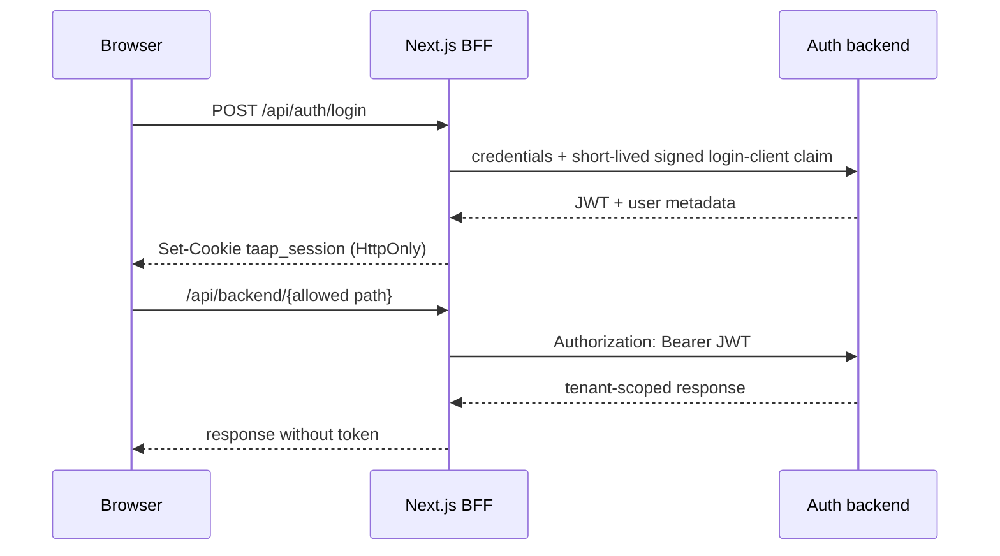

# Frontend and BFF

Next.js 15 / React 18 интерфейс платформы: login, аналитический dashboard, AI-ассистент и supporting views. Frontend содержит same-origin Backend-for-Frontend, поэтому JWT и service API keys не попадают в browser JavaScript.

Рекомендуемый запуск — полный [Compose stack](../compose/README.md):

```bash
docker compose \
  --env-file compose/env/.env.example \
  -f compose/docker-compose.yml \
  up --build --detach --wait
```

UI: [http://localhost:7777](http://localhost:7777), demo login `demo`, password `demo-password-change-me`.

## Auth/BFF flow



Browser-facing routes:

| Method | Route | Назначение |
|---|---|---|
| `POST` | `/api/auth/login` | Login и установка session cookie |
| `GET` | `/api/auth/session` | Проверка текущей сессии |
| `POST` | `/api/auth/logout` | Upstream logout + удаление cookie |
| `*` | `/api/backend/[...path]` | Authenticated proxy к allowlisted backend routes |

### Security properties

- Cookie `taap_session`: `HttpOnly`, `SameSite=Strict`, `Secure` за HTTPS, `Path=/`.
- Cookie `taap_login_client`: opaque random pseudonym, `HttpOnly`,
  `SameSite=Strict`, `Secure` за HTTPS и ограничен `Path=/api/auth/login`.
- BFF подписывает login-client claim отдельным `LOGIN_CLIENT_SIGNING_KEY`;
  version/timestamp/client ID/canonical username связаны HMAC-SHA256.
- JWT никогда не возвращается login route и не сохраняется в `localStorage`/`sessionStorage`.
- Legacy token/password keys очищаются при загрузке; «Запомнить» сохраняет только email.
- State-changing requests требуют same-origin `Origin`/`Sec-Fetch-Site`.
- Proxy разрешает только roots `dashboard`, `ai`, `chatbot` и отклоняет path traversal.
- Request body ограничен потоковым reader даже без доверия к `Content-Length`; upstream redirects не следуются; cookies/Authorization клиента не пересылаются как произвольные headers.
- После upstream `401/403` session cookie удаляется.
- AI-ассистент вызывает `brain/answer` через authenticated BFF и после ответа повторно читает tenant-scoped persisted history.
- Исходящие AI/Telegram сообщения передаются в JSON body, не в query string/URL; service API keys не публикуются в client bundle.
- Next.js на всех routes выставляет CSP, clickjacking/MIME/referrer/permissions/COOP headers; HSTS включается только в production build.

## Data flow

Основной dashboard получает данные через:

```text
Browser → /api/backend/dashboard → auth-backend → demo/live data source
```

AI requests и history идут через `/api/backend/ai/*`; Telegram chat contract — через `/api/backend/chatbot/*`. Tenant scope добавляет auth gateway после проверки JWT.

Локальные server routes с file-based fixtures используются только как UI/demo helpers и не являются production data boundary. Реальные источники должны подключаться через authenticated backend.

## Local UI development

Потребуются Node.js 24.18 LTS, npm 11.16 и запущенный `auth-backend` на
`http://localhost:8001/api`.

```bash
cd frontend-new
npm ci
npm run dev
```

Другой server-to-server backend задаётся только server variable:

```bash
AUTH_BACKEND_URL=http://localhost:8001/api \
  PUBLIC_APP_ORIGIN=http://localhost:7777 \
  LOGIN_CLIENT_SIGNING_KEY=<same-development-key-as-auth-backend> \
  DASHBOARD_DATA_SOURCE=synthetic-demo \
  npm run dev
```

В production container default — `http://auth-backend:8000/api`. `AUTH_BACKEND_URL` должен быть HTTP(S) URL без embedded credentials. Пакетные рекомендации каналов доступны только при явном server-side `DASHBOARD_DATA_SOURCE=synthetic-demo`; в `live` режиме route отказывает fail-closed, пока не подключён аутентифицированный source. Не помещайте токены, API keys или internal URLs в `NEXT_PUBLIC_*`.

## Quality gates

```bash
npm ci
npm run lint
npm run typecheck
npm test
npm run build
npm audit --omit=dev --audit-level=high
```

`npm test` запускает BFF security regression tests и проверки AI demo-контракта: три route-сценария, tenant-neutral payload, browser-scoped session и нормализацию history.

## Project map

```text
frontend-new/
├── app/
│   ├── api/auth/             # login, session, logout BFF routes
│   ├── api/backend/          # authenticated allowlisted proxy
│   ├── chat/                 # AI assistant + persisted history UI
│   ├── dashboard/            # analytics dashboard
│   └── page.tsx              # login page
├── components/               # dashboard, chat and layout components
├── hooks/                    # client state/polling
├── lib/
│   ├── api.ts                # same-origin browser client
│   └── server/               # backend URL + cookie/origin security
├── tests/                    # BFF + AI demo regression tests
└── Dockerfile                # non-root standalone Next.js image
```

## Production notes

- Задайте точный HTTPS `PUBLIC_APP_ORIGIN`; BFF не доверяет входящим
  `Forwarded`/`X-Forwarded-*` при проверке Origin или атрибутов cookie.
- Терминируйте TLS перед Next.js, а на ingress удаляйте клиентские forwarding
  headers и формируйте собственные только для downstream-сервисов, которым они нужны.
- Настройте CSP, rate limiting login/API routes и cache policy на edge.
- Передайте одинаковый уникальный `LOGIN_CLIENT_SIGNING_KEY` (не короче 32
  символов) только BFF и auth-backend; не переиспользуйте JWT/API secrets.
- Ограничьте `AUTH_BACKEND_URL` внутренней сетью; не открывайте auth/AI services напрямую browser-у.
- Замените demo bootstrap account полноценным identity store и lifecycle сессий.
- Не используйте client-side fallback data как business source of truth.
- Проверяйте UI с production-like proxy; `Secure` cookie определяется точным
  `PUBLIC_APP_ORIGIN`, а не caller-controlled forwarding header.

Общая trust model: [`docs/ARCHITECTURE.md`](../docs/ARCHITECTURE.md).
